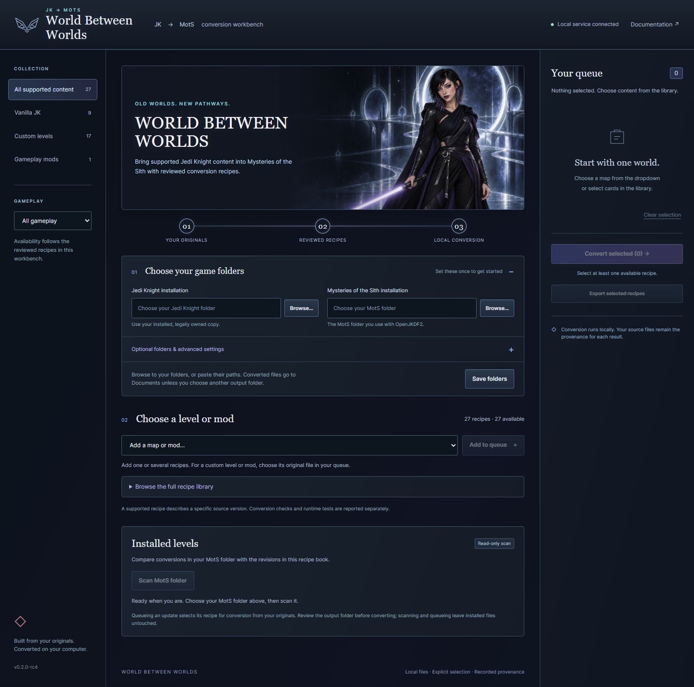

# World Between Worlds

**Bring reviewed Jedi Knight maps into Mysteries of the Sith.**
Local recipe-book converter · Windows 11 / Linux · **Latest prerelease: 0.2.0-rc6 — experimental**

World Between Worlds (WBW) rebuilds selected **Jedi Knight: Dark Forces II** maps
and mods for **Mysteries of the Sith**, using your own game installations and
original downloads. It supplies exact, reviewed conversion recipes. **No retail
assets, community game/mod assets, or finished conversions are included.**

These 1997–98 classics still have a devoted community, preserved in places such
as [The Massassi Temple](https://www.massassi.net/). WBW borrows its name from the
[Star Wars World Between Worlds](https://www.starwars.com/databank/world-between-worlds):
paths connecting different times and places. Here, they connect two classic games
and the worlds their players built.

## Download and start

Get the portable packages from the
[RC6 release](https://github.com/CodaLilitari/World-Between-Worlds/releases/tag/v0.2.0-rc6)
on **CodaLilitari/World-Between-Worlds**. The account restriction may prevent
anonymous downloads and automatic updates; a 404 does not mean your local copy
is broken. For matching source, use the RC6 source ZIP or the
[`v0.2.0-rc6` tag](https://github.com/CodaLilitari/World-Between-Worlds/tree/v0.2.0-rc6).
Ongoing development is maintained on
[`codex/massassi-top50`](https://github.com/CodaLilitari/World-Between-Worlds/tree/codex/massassi-top50).

- **Windows 11 x64:** extract the ZIP, then open `WBW.exe`.
- **Linux x86-64:** extract the ZIP, make `WBW` executable if necessary, then run
  `./WBW`. Requires a desktop session and glibc 2.35 or newer.

The app opens in your browser and runs locally. **Python is included in standalone
builds**; no Python setup, Gradio, PyTorch, GPU, API key, or paid service is needed.
Its illustrated gothic interface is completely silent.

## Convert a level

1. **Choose your games.** Click **Browse** for your legally owned Jedi Knight
   installation, then your MotS installation. Pasting folder paths also works.
2. **Check older conversions.** Click **Scan MotS folder** to see which installed
   WBW levels are current, older, unversioned, changed, or duplicated. Queue only
   the updates you want. The scan changes no files.
3. **Choose Levels or Mods.** Levels contains stock and custom maps; Mods contains
   optional gameplay conversions such as Ninja Kage. Add entries to your queue
   using the dropdown. Search and gameplay filters stay within that section.
4. **Supply the original when needed.** For a custom level or mod, select its
   original ZIP/GOB. **Download original** opens the reviewed author's/archive page;
   download it there, then come back and explicitly choose the file. Stock maps
   use your installed game files.
5. **Convert your queue.** Outputs go to `Documents/World Between Worlds conversions`
   unless you choose another folder under advanced settings. Follow each result's
   generated instructions to install and launch it in OpenJKDF2's **MotS mode**.

Nothing is selected by default. Converting several entries produces separate
results; it does not combine or automatically load mods. **Ninja Kage 7.0** is an
optional prototype recipe, with its remaining limits shown before conversion.

**CTF levels require an additional support mod.** For the three stock CTF maps,
WBW generates `bridge-ctf-ui` alongside the level. Every player must install that
folder and launch with `-motsCompat -path bridge-ctf-ui`; then select the **CTF**
episode in Multiplayer. The UI shows this requirement before and after conversion.
Custom CTF recipes must declare their own reviewed requirements; the stock mod
is not automatically compatible. [CTF installation](packaging/USER_GUIDE.md#capture-the-flag).

New GOOs carry a recipe revision, for example `bridge-canyon_wbw_v1.goo`.
The scanner checks the embedded record rather than trusting a renamed filename.
When replacing an older installation, follow the generated instructions and
update any required startup folder too; WBW does not delete or overwrite your
installed levels. [Revision details](RECIPES.md#installed-recipe-revisions).

## What's supported?

The **0.2.0-rc6** candidate contains **53 recipe records, 52 selectable**:
nine stock JK multiplayer maps, 32 custom multiplayer entries (including packs),
five custom singleplayer entries, and six optional mod prototypes. Canyon Oasis,
the three stock CTF maps, Jedi's High School, Caesar's Palace, SM Purgatory, MLP3
and Imperial Siege are included. Castle Conflict remains unavailable pending its
engine prerequisite. Only the reviewed original versions are accepted.
Recipe availability is separate from gameplay qualification; see the
[release scope and remaining checks](docs/releases/0.2.0-rc6.md) and
[development checkpoint](docs/top50/WAVE3_CHECKPOINT.md).

- [Custom levels, authors and original download URLs](SUPPORTED_CUSTOM_SOURCES.txt)
- [Per-map details and known differences](COMMUNITY_RC1.md) · [Ninja Kage](NINJA_KAGE.md)
- [User guide, installing outputs and updates](packaging/USER_GUIDE.md)
- [Launch/testing guide](TESTING.md) · [Validation and limits](VALIDATION.md)
- [Exact recipes and optional command-line reference](RECIPES.md)
- [Comparison screenshots and artwork provenance](SCREENSHOTS.md)

This remains an experimental compatibility tool. Structural verification and
selected multiplayer host tests are documented; they do not establish complete
gameplay or multi-client parity for every map or mod. Use the recorded limitations
when deciding what to test.

## Updates, credits and terms

Development work: [50 Massassi entries per category](docs/top50/README.md), with
source review and test status tracked separately from released compatibility.

RC6 checks `CodaLilitari/World-Between-Worlds` releases on launch, verifies compatible updates,
and keeps a working fallback. It can run offline; `--no-update` skips the check.
**The CodaLilitari account is currently restricted. Public automatic update
delivery remains unconfirmed; an authenticated release check cannot establish
anonymous access.** A downloaded copy works offline with `--no-update`.
Application updates and individual recipe revisions are separate. Optional source
and command-line use require Python 3.10+: extract the RC6 source ZIP or check out
the `v0.2.0-rc6` tag, then run `python blackwing_launcher.py`.
Older packages still name the former publisher and cannot automatically switch
repositories. Install an RC6 package manually to change the update source.

Original tooling by **Andrei Pemberton**, with **Coda Lilitari in Astra Codex**.
Original map and mod authors retain their credits. WBW is separate from our
[OpenJKDF2-MotS-Fixes engine fork](https://github.com/CodaLilitari/OpenJKDF2-MotS-Fixes)
and from upstream OpenJKDF2. No Lucasfilm or LucasArts affiliation is claimed.

The [MIT license](LICENSE) covers our original software and documentation.
Original-content terms remain separate: requiring your originals and publishing
recipes avoids bundling or reuploading those assets, but grants no permission to
redistribute generated levels. See the [provenance and asset boundary](NOTICE.md).
