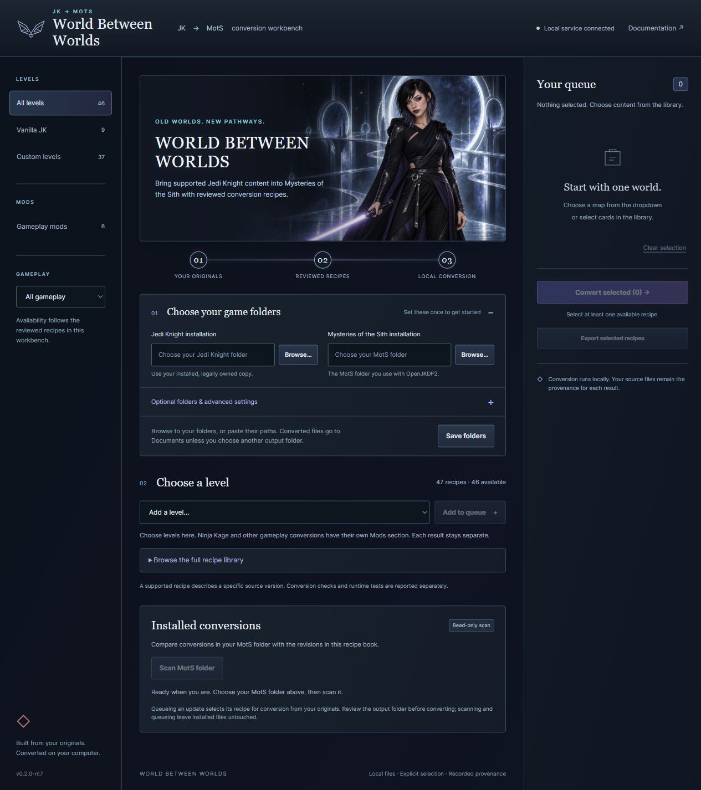
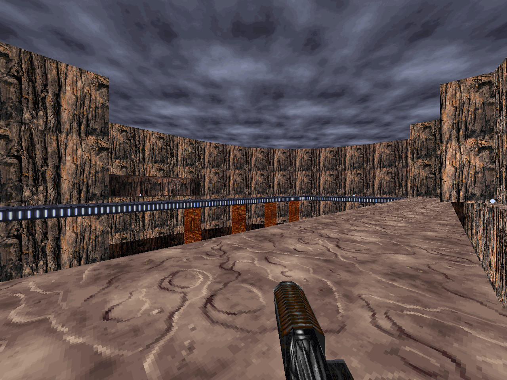
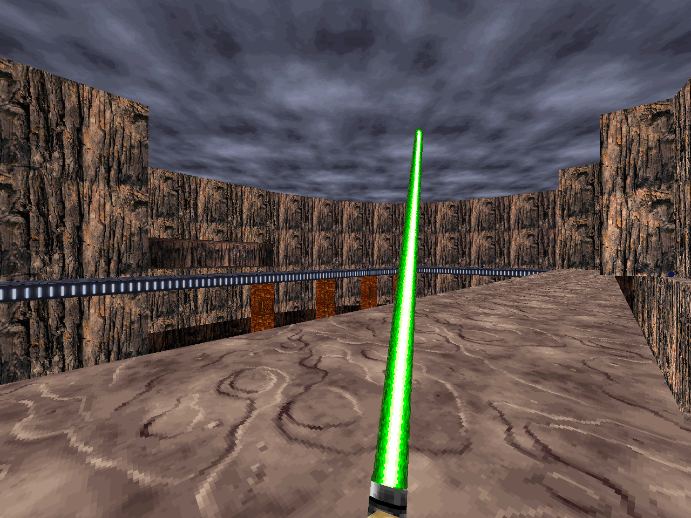
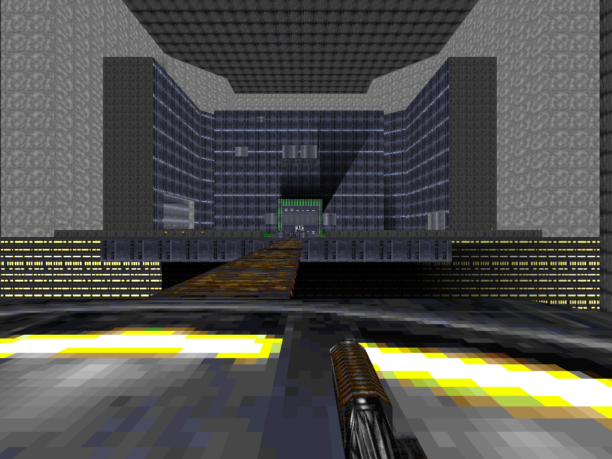
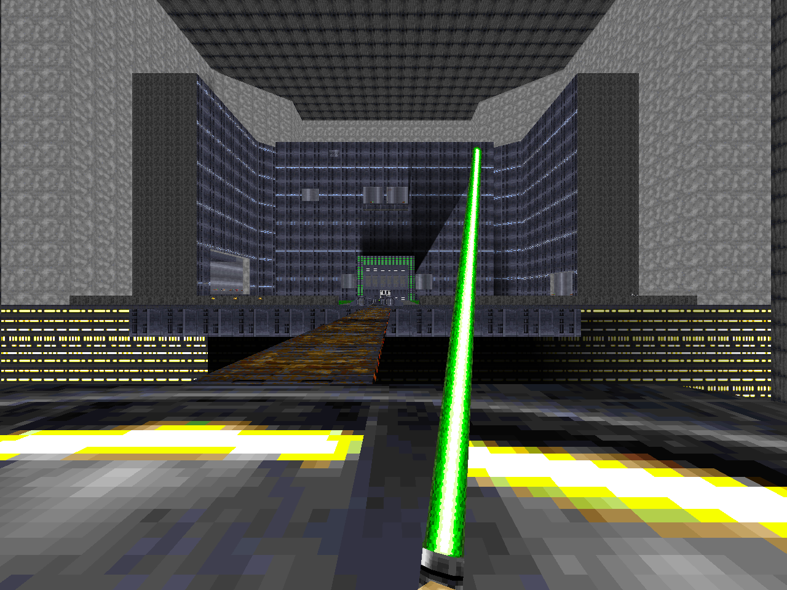
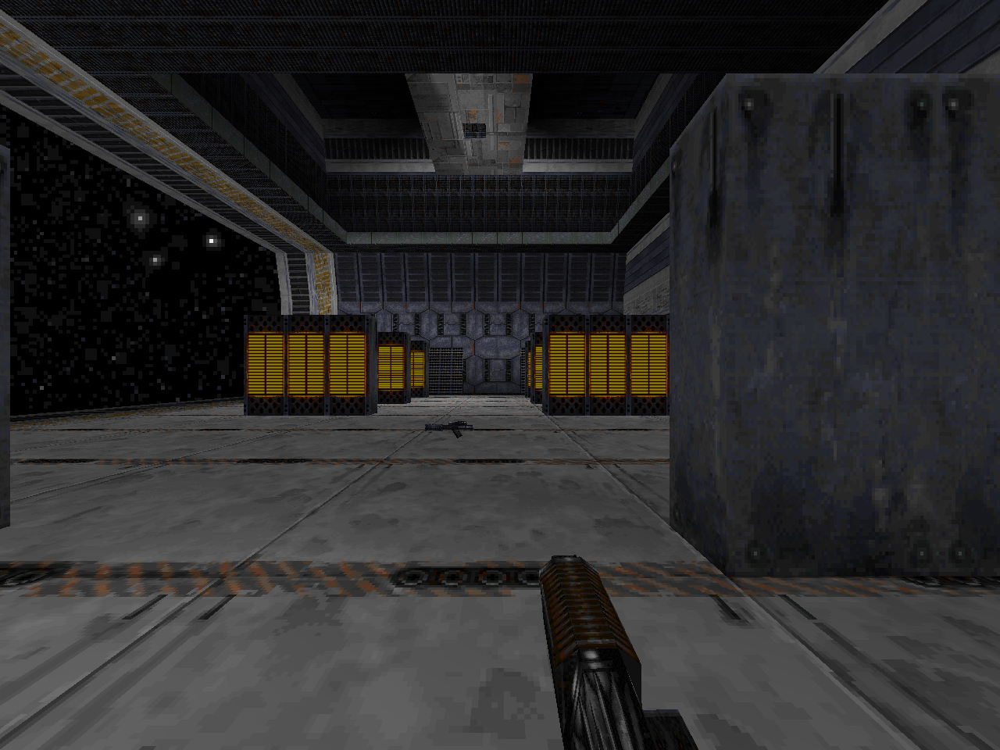
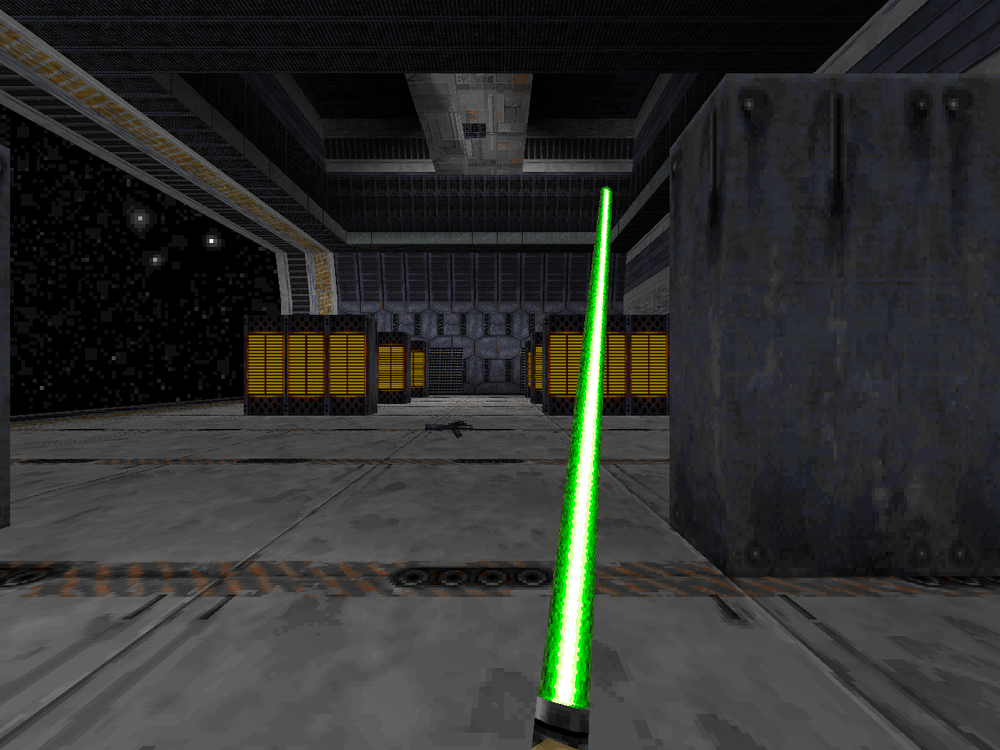
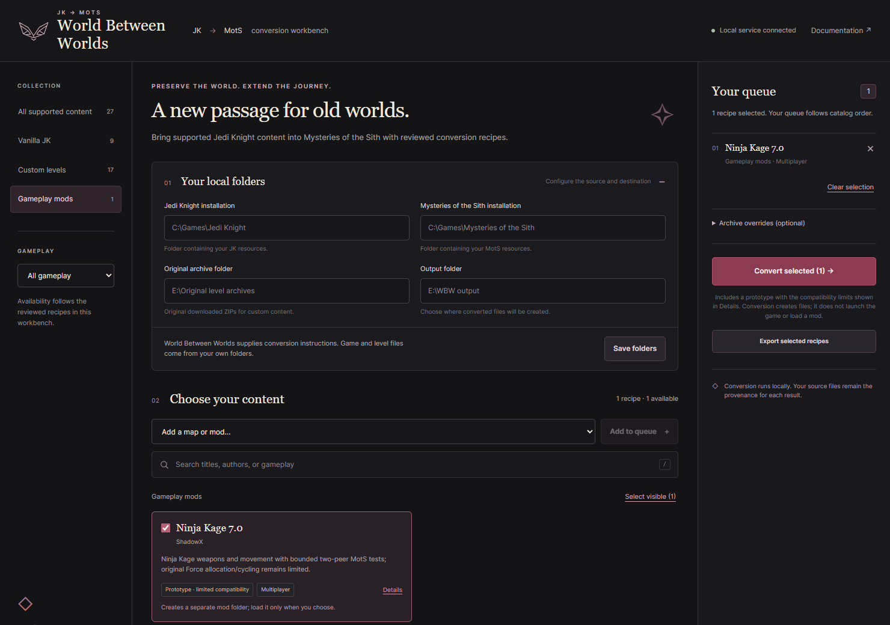
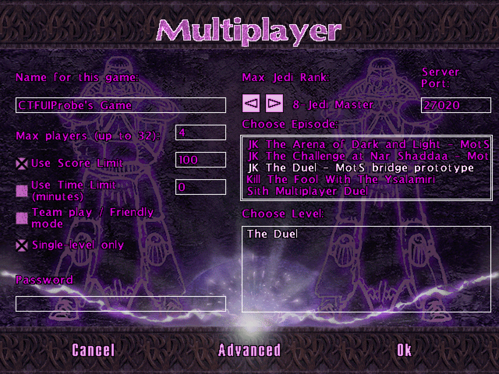
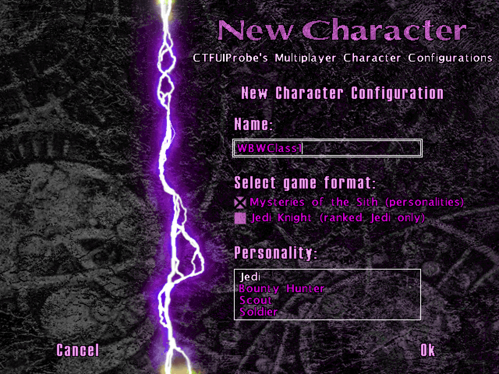

# World Between Worlds documentation screenshots

## RC7 workbench

Captured September 30, 2026 from the actual RC7 source application's local
browser interface, with isolated empty settings and automatic updates disabled.
The 1265 x 1426 JPEG is an unretouched full-page browser capture. No game folders
were selected and no conversion or game was run. The existing original Coda
illustration is part of the interface; this is UI documentation, not evidence
of gameplay. SHA-256:
`2f37b66fcb70c2b11011d23f2baee1e93b93c0e376b3ae7b5e26020f0ae8d90e`.

## Original JK and converted MotS views

These six images are actual 1280 × 960 game framebuffer captures from three
multiplayer levels. The left column uses the original archive in OpenJKDF2's
JK mode; the right column uses the locally converted archive in its MotS mode.
The original column does not use the retail JK executable.

| Map | Original JK | Converted MotS |
| --- | --- | --- |
| Canyon Oasis |  |  |
| Jedi's High School 1.0, PeD_HeAd |  |  |
| Nar Shaddaa Loading Terminal |  |  |

In each pictured pair the camera matrix, sector and field of view match.
Inspection found the corresponding visible geometry and materials present.
These views provide useful evidence that converted geometry, textures and
lighting render. A single view cannot establish complete traversal or every
surface, trigger, weapon and multiplayer interaction.

A private diagnostic build enabled hidden rendering and framebuffer capture,
with the camera placed at the authored first multiplayer spawn plus a fixed
eye-height offset. Both modes used the same build, based on the tested
OpenJKDF2-MotS-Fixes runtime. The diagnostic changed no map, lighting or shader
data. These are original framebuffer images without resizing, retouching,
compositing or image generation. Animation phases were not synchronized to an
exact simulation tick. The native starting weapons differ: JK shows a Bryar
pistol and MotS shows a green lightsaber. These are not matched weapon loadouts.

[Machine-readable provenance](docs/screenshots/provenance.json) records the
capture method, runtime and archive hashes, image hashes, settings, source URLs,
and the limits of the observations. The reviewed originals are listed in
[SUPPORTED_CUSTOM_SOURCES.txt](SUPPORTED_CUSTOM_SOURCES.txt).

The screenshots illustrate compatibility and preserve the original game's and
level author's attribution. They are documentation in the repository; they are
excluded from the source, native application and updater ZIPs. The application
packages contain no game assets. See [NOTICE.md](NOTICE.md).

## Selecting a mod to convert

This unedited 1480×1040 screenshot shows Ninja Kage selected in an isolated
headless Chrome test, with the prototype limit and separate mod output explained.
The visible folder examples are empty-field placeholders; the screenshot was
taken before entering local paths. The accompanying browser test checked that a
map-only conversion omits Ninja entirely, while explicitly selecting both creates
separate results. [Screenshot and conversion provenance](https://github.com/CodaLilitari/World-Between-Worlds/blob/v0.2.0-rc1/docs/validation/ninja-selection-20260908.json)
records the exact source and output hashes. Conversion does not launch a game or
load the resulting mod.

## Native MotS selection of converted CTF episodes

The existing **Choose Episode** list offers the converted CTF episodes alongside
the stock MotS episodes. The native OK result returned the correct TYPE 8 map
for [The Duel](docs/screenshots/ctf-host-duel.png),
[The Arena of Dark and Light](docs/screenshots/ctf-host-arena.png)
and [The Challenge at Nar Shaddaa](docs/screenshots/ctf-host-challenge.png).
Long episode titles clip within the original list box; the selected level is
shown in the lower box. CTF is selected through the episode rather than a separate
game-mode button. No CTF-specific host-menu change was added.

The native character form distinguishes **Mysteries of the Sith (personalities)**
from **Jedi Knight (ranked Jedi only)**. The test used the four native personality
choices, saved each character and reloaded all four with the room fields returned
by the CTF host menu. The [Scout selection capture](docs/screenshots/ctf-load-scout.png)
shows The Duel, the selected saved character and its Scout personality together.

These five original 1280 × 960 PNGs are unchanged captures from a fifteen-frame
native-menu replay on the pinned e9-based private diagnostic. The driver invoked
normal in-process GUI handlers and read its own hidden window framebuffer; it
used no physical OS input, synthetic image, retouching or resizing. The
[sanitized evidence](https://github.com/CodaLilitari/World-Between-Worlds/blob/v0.2.0-rc2/docs/validation/ctf-native-menu-20260908.json)
records exact provenance and image hashes. No network game was started by this
GUI test, so the images do not establish flag mechanics, scoring or multiplayer
personality behavior. These are repository documentation only; all five are
excluded from application and updater ZIPs.

## RC4 original interface illustration

The RC4 interface uses **Light Sith Coda at the World Between Worlds**, an
original illustration generated with Codex's built-in image-generation tool on
September 9, 2026. It follows the canonical Coda character sheet supplied and
designated by the user; that reference sheet is not distributed. The face,
freckles, short dark hair with cool ends, and eyebrow jewelry were checked
against that reference. The Sith-inspired outfit and portal setting are this
commission's interpretation, not additions to the character's canonical sheet.

- [Native illustration](docs/art/coda-wbw-v1.png): 1672 × 941 PNG, preserved without
  resizing or retouching.
- SHA-256: `f48c5346f97ee7b7c1ba5134b53a54b8e64f7929288b9b7badd5097b29379c1b`.
- [Exact generation prompt](docs/art/coda-wbw-v1-prompt.txt).
- One explicit character-reference image was used; no game, mod, film still,
  reference-sheet panel, or third-party promotional art is embedded in the result.
- The application embeds the same PNG bytes in `ui/coda-wbw.js`. This keeps
  updates compatible with older launchers' allowed UI file types. The encoding
  is for original interface artwork, not a hidden game-asset payload.
- The image is decorative, has descriptive alternative text, and does not
  replace functional controls. There is no music, audio playback, or sound toggle.

The interface's uppercase serif title, clean functional type, near-black,
silver, ice-blue and muted-violet palette carry over the style of the latest
corrected WBW publicity ad. This illustration is presentation artwork; it is
not a screenshot or evidence of game compatibility.

## RC4 workbench capture

The main README now shows the [RC4 workbench](docs/screenshots/workbench.png),
a 1440-pixel-wide, unretouched headless Chrome capture with empty game-path
fields, placeholders and an empty queue. The original illustration was loaded
from the application's embedded PNG. SHA-256:
`70a7728fc52237151d903baa23cff23467899fd8e08c94db5a57ba65e944afa4`.
The [previous workbench image](docs/screenshots/workbench-rc2.png) is preserved.

The [browser test record](docs/validation/wbw-interface-rc4.json) distinguishes
real local-server scanning from mocked native-chooser responses. It checked
folder selection, original selection and cancellation, reviewed source links,
explicit queueing, revision states and duplicates at desktop and 390-pixel
mobile widths. No real native dialog, conversion or game was opened by that
browser test, and no browser errors or unexpected external requests occurred.
The native chooser and actual conversions have their own separate tests.
