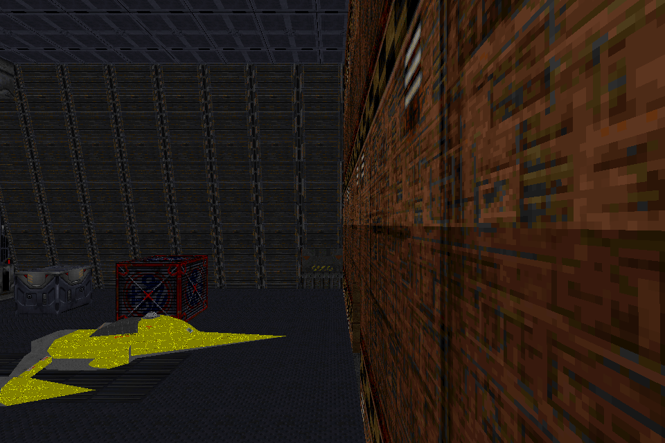
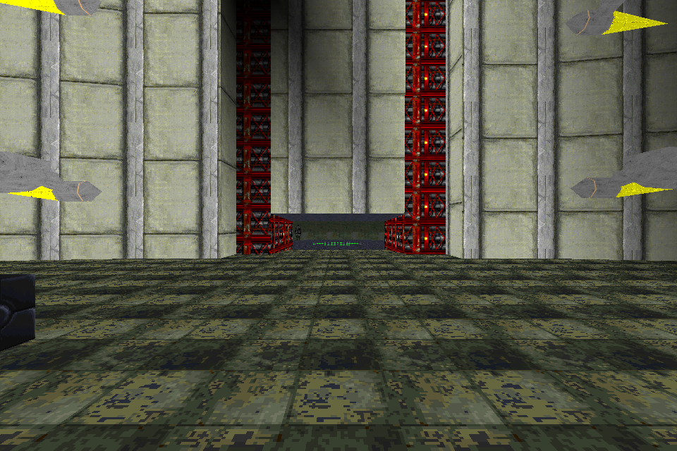

# Two SP prototypes: original and converted views

September 12, 2026. These are real engine screenshots of privately supplied
original levels and WBW conversions, using **OpenJKDF2 in JK mode** and the same
executable in **MotS mode**. They are documentation images, not distributable
level/mod resources. No retail executable was used.

The engine's opt-in hidden capture fixes the inspection camera and writes its
own frame without desktop screenshots or keyboard/mouse input. Each pair uses
the same position, sector, orientation, horizontal FOV, resolution and visual
settings. Simulation still runs normally; this is not deterministic gameplay.
The player, AI and authored scripts were not edited for these captures.

## The Phantom Menace: Final Battle (Revised)

Original level by **Darth Maul**. [Original Massassi listing](https://www.massassi.net/levels/files/23.shtml).
Recipe: `sp-phantom-menace-final-battle`, revision `wbw_v1`.

| Original JK level, OpenJKDF2 JK mode | WBW conversion, OpenJKDF2 MotS mode |
| --- | --- |
|  |  |

The visible corridor boundaries, wall and floor textures, crates and lighting
align. The camera faces along the starting corridor; the authored start facing
points at a close wall and was unsuitable for an informative comparison.
Of 614,400 pixels, 614,397 were identical in this particular pair. That does not
establish pixel parity for other views, scene times or the retail renderer.

## Legends of the Force: Darth Maul vs. Qui-Gon Jinn

Original level by **BoBo Fett**. [Original Massassi listing](https://www.massassi.net/levels/files/26.shtml).
Additional source details and original notice hashes are in the [ranked SP inventory](SP.md).
Recipe: `sp-maul-vs-qui-gon`, revision `wbw_v1`.

| Original JK level, OpenJKDF2 JK mode | WBW conversion, OpenJKDF2 MotS mode |
| --- | --- |
|  |  |

Pillars, walkway outlines, material placement and illumination align in this
view. The far character is present in both captures. Of 614,400 pixels, 614,365
were identical in this pair. This does not validate the character's complete
animation set, AI behavior, scripted duel or mission completion.

## Reproduction and limits

[The evidence record](sp-rendered-evidence.json) pins the input archives, original
downloads, engine binary, requests, output images, cameras and private launcher
receipts. The capture executable is SHA-256
`c21e9e97314c7eb884a52c3dfab6256c859f887aef58c8ca771dfc829917e536`,
associated with engine commit `b1be98bd4f170b5384cb71b15443a274aac6a937`.
The exact camera and image format can be replayed using the engine fork's
`docs/HIDDEN_RENDERED_CAPTURE.md` request contract.

Every accepted capture exited successfully at frame 3, produced a valid 960x640
RGB image and sidecar, and preserved the source and staged resource hashes.
No visible or foreground window belonging to the child was observed during
100 ms polling. Sampling cannot exclude a transient between observations.
The PNGs are lossless transcodes checked against the captured RGB pixels.

The initial MotS launcher attempts incorrectly prefixed the SP world names and
exited before capturing a frame. The corrected launcher uses the actual world
entries, whose authored names and episode progression WBW preserves. Those
failed attempts are retained privately; they were not conversion passes and
did not require a recipe change.

These two views add bounded visual evidence to the separate structural and
hosted-load checks. Full map exploration, moving doors/elevators, collision,
AI, Force interactions, objectives, saves and progression remain open. No map
or mod status is promoted by these screenshots alone.
