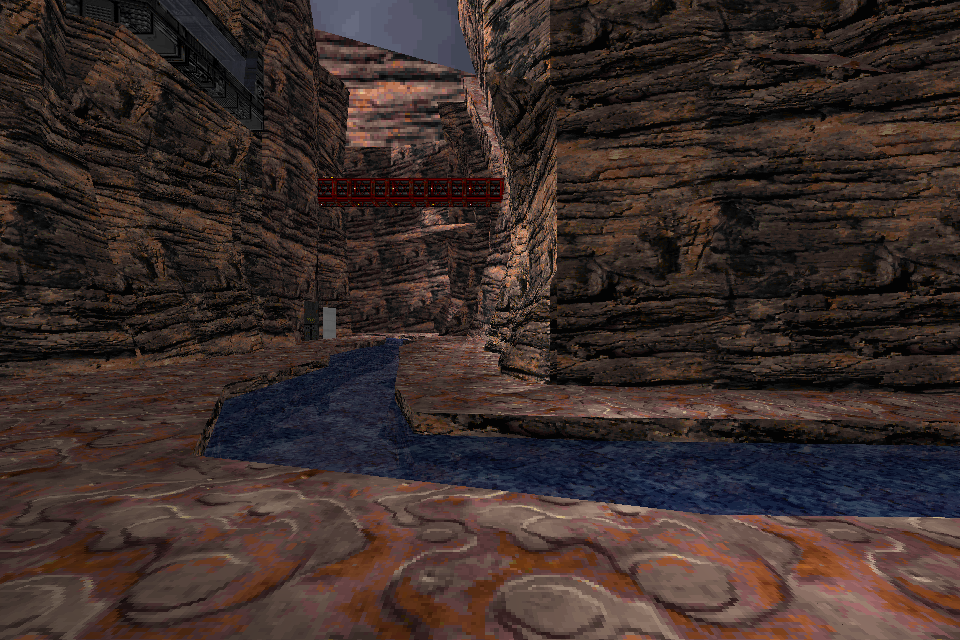
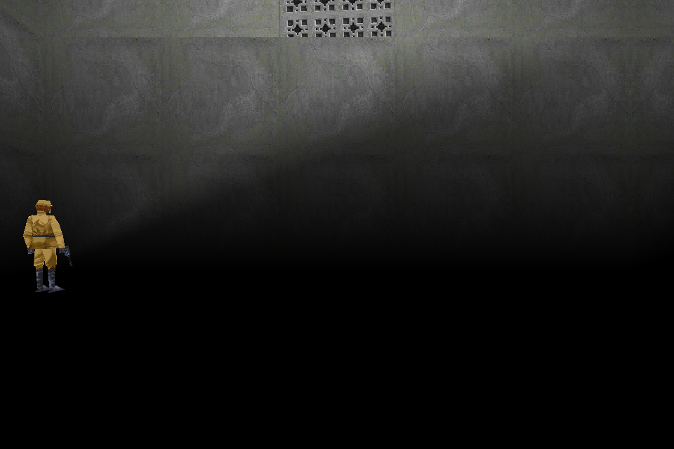
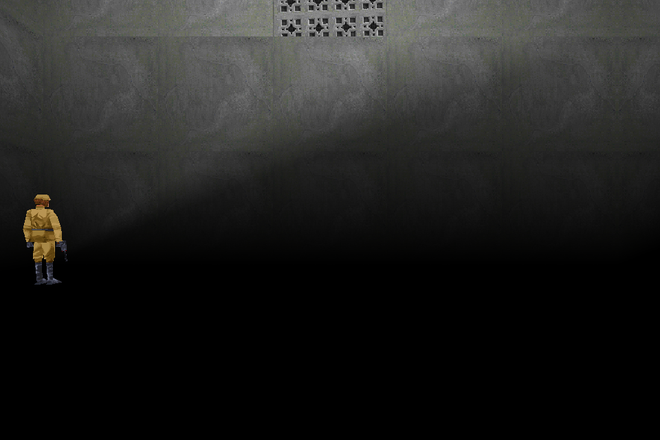

# Canyon Stream and Steal the Bottle: development evidence

September 20, 2026. Both recipes are **prototypes**, with separate structural,
initial rendered and bounded simulation evidence. Neither is a complete
gameplay, multiplayer-peer or retail-parity pass.

## Canyon Stream

[Original level](https://www.massassi.net/levels/files/964.shtml) by
**Justin (Juz) Stocks / Juztyn**. Recipe `canyon-stream`, revision `wbw_v1`.

The conversion preserves all 173 placed things, 9,490 surfaces, 1,061 sectors,
the authored environment scripts and two neutral Force surge locations. Ordinary
pickups use reviewed native MotS controllers. The authored concussion turret
remains distinct from the ordinary concussion weapon binding. No startup mod is
required.

Choose the original `canyonstream.zip`, including `canyonstream.txt` and
`walkthrough.txt`. The end-user service verifies and preserves both notices;
a bare extracted GOB does not contain them and is not an accepted service input.

The original lacks `00_glass.mat` at two precisely reviewed references and
`df_machine2.wav` at two others. The turret sound can be active: its absence is
an inherited potentially silent cue, **not an unused dependency**. The exact
source-hash/referrer rules preserve those omissions without replacement assets.
Other missing references still fail verification. Undeclared source symbols and
the frame-less bomber emitter remain explicit original-behavior caveats.

| Original JK episode in OpenJKDF2 JK mode | Conversion in OpenJKDF2 MotS mode |
| --- | --- |
|  |  |

The inspected canyon walls, bridge, stream and material placement align. Five of
614,400 pixels differ in this initial pair; simulation was not deterministic.
The exact converted payload also passed a 45-second hidden MotS MP host check:
correct world/mode, advancing simulation, explicit clean mounts, unchanged
original/staged inputs and no resource diagnostics. This does not exercise the
dam, lifts, breakable glass, bomber, turret, reactor or underwater movement.

## Steal the Bottle

[Original level](https://www.massassi.net/levels/files/1046.shtml) by
**Cave_Demon**. Recipe `sp-steal-the-bottle`, revision `wbw_v1`.
The [source and transformation review](STEAL_THE_BOTTLE_REVIEW.md) records the
exact single saber-bin edit, authored AI, goals, placement and ending conditions.
All 42 placed things remain, including three intentionally disabled source tanks.
No additional Force powers, invented combat behavior or new bottle pickup is added.

| Original JK episode in OpenJKDF2 JK mode | Conversion in OpenJKDF2 MotS mode |
| --- | --- |
|  |  |

The inspected wall, vent, light falloff and guard appearance align. The guard
has advanced to a slightly different animation pose: 3,613 of 614,400 pixels
differ. This fixed spawn view covers only a small portion of the level. The
converted payload also passed 90 seconds of hidden MotS SP simulation with the
correct world/mode and no resource diagnostics. Patrol, doors, conveyor/thrust,
the final surface crossing, save/load and full traversal remain unverified.

## Reproducibility and boundaries

Both outputs were rebuilt in separate fresh processes under Python hash seeds
1 and 999 with identical game archives and accompanying manifests/notices.
The independent verifiers checked the original-source transformations, world
preservation, exact omission scope and native resource ownership. The SP suite
passed 41 tests; the MP/community/Force/bridge subset passed 87 tests, including
new negative controls. These suites have narrower scopes than complete game play.

[The asset-free runtime receipt](wave3-level-runtime-evidence.json) pins exact
payloads, the engine executable, requests, images and private observation reports.
The engine is commit `28ec799f1dab3f3954b4d395d19711c2204c43b1`, executable SHA-256
`4b208d7455223e1d6dd059938cb9c128b2dc4d97ff76ca1f00c891cc24ffdf94`.
This is a private fork build, not a delivered release prerequisite.

Captures came from the engine's hidden render path, not the desktop. No visible
or foreground owned windows were observed during sampling. Sampling cannot
exclude a transient between observations. Original/staged files were hashed
before and after. Screenshots are permitted documentation; originals, retail or
custom assets, private source-bearing audits and generated conversions stay local.
The recipe metadata does not grant redistribution rights to the level assets.
