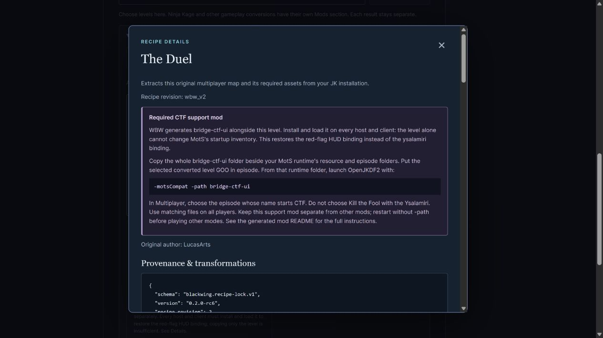
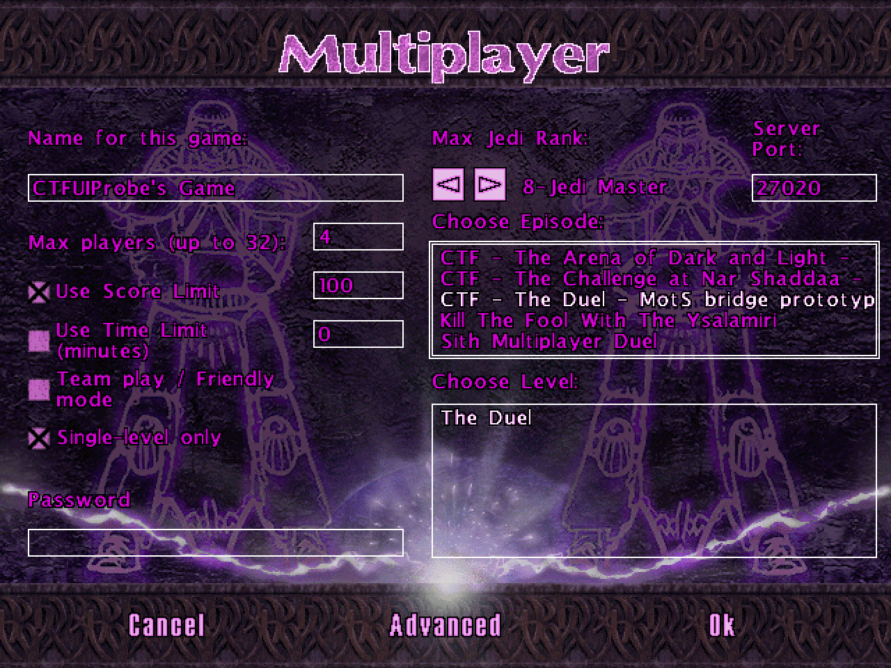

# CTF setup, native menu and historical-port review

September 25, 2026. WBW RC6 changes CTF presentation and episode titles; it
does not add a new engine mode or qualify complete multiplayer gameplay.

## What users see

The dropdown, library cards and queue explicitly flag **CTF mod required**.
Details and completed results show installation instructions and the generated
support-mod folder. For the three stock maps, every host/client must mount
`bridge-ctf-ui` at process startup with `-motsCompat -path bridge-ctf-ui`.
Copying only the level is insufficient. The generated mod changes native MotS
inventory descriptor 81 from `ysalamiri` to `redflag`; it preserves all other
rows. Native ysalamiri gameplay inventory at bin 68 is deliberately unchanged.

All three converted episode titles now begin **CTF -**, keeping that label
visible even when the native list clips the longer suffix. Their revisions
advance from `wbw_v1` to `wbw_v2`; scanning identifies older outputs. A member
comparison against RC5 shows only `episode.jk` changes among game payloads.
The WBW tracking marker changes as expected. The support-mod payload is unchanged.

## Native MotS menu and production hosts

A fresh hidden native-menu replay selected all three new payloads and returned
their correct worlds and TYPE 8. The **Kill The Fool With The Ysalamiri** episode
remained a separate, unselected row. The screenshot shows actual native menu
rendering rather than a mockup.

The replay used the existing diagnostic engine based on `e9e293a7`, executable
SHA-256 `02ebed76650cf64ce90352a73c301dc1c0319921aab2464a9cf05b5daec2ab9f`.
Its driver requires legacy filename aliases; the aliased files were byte-identical
to the newly generated revision-2 GOOs. The three native menu source files are
unchanged at the current inspected engine checkout `b1be98bd`. This replay did
not start a network game and was not a fresh build of current engine HEAD.

Separate **30-second production hosts** loaded each actual revisioned filename
with the required startup mod. All three advanced simulation, retained matching
input hashes, had no parser/load diagnostics and exposed no owned visible window.
They used the pinned production engine `f40e965b`, executable SHA-256
`46082078c608a956e1012af3803fd89777e231fa6754efb078dacd0eb0c23165`.
This is an explicit build qualification, not a test of every later engine binary.

| Map | Actual output | Host result |
| --- | --- | --- |
| The Duel | `bridge-ctf_duel_wbw_v2.goo` | Passed 30-second startup/host gates |
| The Arena of Dark and Light | `bridge-ctf_arena_wbw_v2.goo` | Passed 30-second startup/host gates |
| The Challenge at Nar Shaddaa | `bridge-ctf_challenge_wbw_v2.goo` | Passed 30-second startup/host gates |

Active descriptors were `redflag` at 81 and `goldflag` at 82. The native host's
unchecked Team Play setting started at flags `0x90`; the original CTF controller
changed live flags to `0xA7`. Its startup sets team/friendly/custom-score rules
and disables automatic team assignment, leaving the original red/gold route to
choose teams. Therefore these preserved recipes do not require manually ticking
Team Play to activate CTF. Historical ports' instructions are not automatically
instructions for WBW's different script set.

[Runtime identities, observations and limits](ctf-runtime-20260925.json) bind
these observations to the exact payloads. Flag pickup/drop/return, capture,
scoring, audible effects, connected second-peer play and retail MotS parity
remain untested by this follow-up. A correct descriptor is not a screenshot of
a carried flag; surviving a host run does not prove the complete flag lifecycle.

## The 1998 conversion and lighting

The historical match is **hedge's MotS CTF 1.0, April 1998**, preserved outside
Massassi. Its [original README](https://jkdf2.net/JKBot/JKArchive/JKDF2/JKDF2/Game%20Files/motskfy/info/motsctf/motsctf.txt)
describes omitted colored lights and an optional inventory override for the
ysalamiri icon. **Marc Sauvé's February 1999 port** explicitly builds on hedge's
work; its [README](https://jkdf2.net/JKBot/JKArchive/JKDF2/JKDF2/Game%20Files/motskfy/info/sith-ctf/sith-ctf.txt)
and archive show a different icon override. Their three JKLs are byte-identical.

Numeric comparison against owned stock JK data found a more specific lighting
loss: the historical ports zero all **99** nonzero surface extra-light values
in Arena and all **474** in Challenge. The Duel had none to lose. Sector ambient,
extra light and tint are unchanged; corner-light rounding is at most 0.000005.
This establishes source-data loss, not its rendered severity on a given renderer.

An independent check of the **actual WBW revision-2 outputs** preserved all
573 nonzero extra-light values and exactly replicated each original scalar
corner value into MotS's on-disk interleaved A/R/G/B representation, across
17,407 surfaces. The engine reads interleaved values on disk and stores channel
blocks in memory; those formats must not be confused.

See [historical provenance and comparisons](ctf-historical-20260925.json) and
[independent full-output lighting check](ctf-lighting-20260925.json). The old
archives and readmes remain private original research inputs; this repository
contains metadata and documentation screenshots only. WBW still converts the
user's owned originals through recipes and does not distribute either old port.

## Custom CTF applicability

The UI requirement is based on the reviewed `ctf` gameplay classification,
independent of stock/custom category or recipe ID. A different custom system
shows its own declared instructions, without assuming `bridge-ctf-ui` works.
UI tests exercise both categories, alternate custom dependencies, successful
results and failed conversions.

No custom CTF recipe is currently enabled. The registered community single maps
and pack worlds are TYPE 2. An audit of the 50 frozen JKMP originals found three
unregistered TYPE-8 entries (AIWARS, AI Trench Wars and The Death Star) whose
scripts/readmes do not establish flag-capture gameplay. Conversely, an `astrctf`
world filename alone does not establish CTF. Review original controllers and
objectives before adding CTF classification or a support-mod dependency.

The permanent [resource workflow](../RESOURCE_WORKFLOW.md#ctf-recipe-gate-stock-and-custom)
requires this review for future custom CTF recipes. No SED-only edits or hidden
manual asset changes were used; the released title change replays through WBW.
